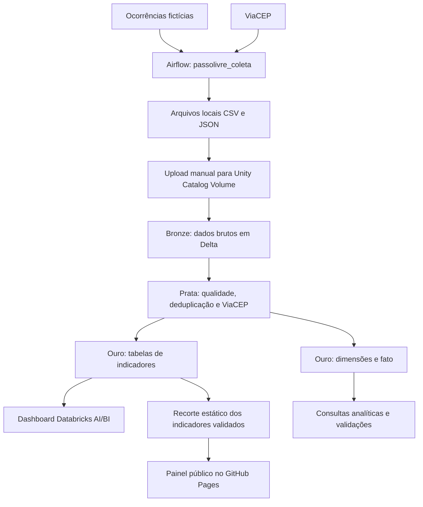

# PassoLivre — Big Data Architecture & Data Integration

**Global Solution 2026.2 — FIAP**

**[Acessar o MVP público — Painel de Acessibilidade](https://sabi-hase.github.io/passolivre-bigdata/)** · [Código-fonte no GitHub](https://github.com/Sabi-Hase/passolivre-bigdata)

## Integrantes

| Nome completo | RM |
|---|---|
| Leticia Resina | 98069 |
| Sabrina Flores | 550781 |
| Gabriel Riqueto | 98685 |

Projeto acadêmico de engenharia de dados vinculado ao produto CitizenTech **PassoLivre**, voltado à coleta, organização, validação, integração e análise de registros de barreiras de acessibilidade urbana.

> **Dados demonstrativos:** as ocorrências utilizadas são fictícias. Os CEPs se referem a localidades reais, mas os problemas descritos não representam necessariamente situações existentes nesses endereços. Os resultados não constituem estatísticas reais de acessibilidade urbana.

## 1. Objetivo

Demonstrar uma arquitetura de dados capaz de:

- Orquestrar a coleta de ocorrências e o enriquecimento de CEPs.
- Armazenar dados de chegada e processá-los em camadas **Bronze, Prata e Ouro** (arquitetura Medallion).
- Aplicar deduplicação, regras de qualidade e tratamento de endereços.
- Construir um **modelo dimensional Star Schema**, com uma tabela fato e duas dimensões.
- Responder a perguntas analíticas sobre localização, tipo de barreira e bloqueio total.
- Disponibilizar indicadores em um **dashboard analítico** no Databricks e em uma **demonstração web pública** no GitHub Pages.

O projeto demonstra o fluxo de engenharia e consumo analítico de dados; não implementa, nesta versão, uma aplicação completa de registro de denúncias ou uma API externa para o MVP.

## 2. Arquitetura da solução



**Limite da automação:** o Airflow orquestra a coleta local. Nesta demonstração, o envio dos arquivos ao Databricks e a execução dos comandos SQL foram realizados **manualmente**. O painel do Databricks é o MVP analítico original; a versão publicada no GitHub Pages é uma **demonstração estática e interativa** dos resultados validados, sem atualização em tempo real.

## 3. Tecnologias utilizadas

| Tecnologia | Uso no projeto |
|---|---|
| Python | Coleta, preparação e validação de amostras |
| Apache Airflow 3 | Orquestração da DAG `passolivre_coleta` |
| Docker / Docker Compose | Execução local da infraestrutura |
| PostgreSQL e Redis | Serviços de suporte ao ambiente do Airflow |
| ViaCEP | Enriquecimento de dados de CEP |
| Databricks SQL | Ingestão, transformação, validação e consultas |
| Unity Catalog Volumes | Recebimento dos arquivos CSV e JSON no Databricks |
| Delta Lake | Armazenamento das tabelas Bronze, Prata e Ouro |
| Databricks AI/BI Dashboards | Visualização dos indicadores |
| HTML, CSS e JavaScript | Painel público com filtros executados no navegador |
| GitHub Pages | Hospedagem pública da demonstração interativa |
| Mermaid / Markdown | Diagramas e documentação técnica |

## 4. Organização do repositório

| Diretório ou arquivo | Finalidade |
|---|---|
| `amostras/` | Dados de exemplo utilizados no projeto |
| `dags/passolivre_coleta.py` | DAG de coleta e conferência |
| `chegada/ocorrencias/` | Arquivos CSV produzidos localmente |
| `chegada/viacep/` | Arquivos JSON produzidos localmente |
| `databricks/` | Scripts SQL das camadas e das consultas |
| `scripts/` | Scripts de validação e utilitários |
| `docs/` | Modelagem, resultados, privacidade, integração e site público (`docs/index.html`) |
| `evidencias/` | Capturas de tela da implementação e dos resultados |
| `config/` e `plugins/` | Configuração e extensões locais do Airflow |
| `logs/` | Logs gerados pela execução local |
| `docker-compose.yaml` | Definição dos serviços Docker |
| `.env` | Configurações locais de ambiente; **não publicar segredos** |
| `.gitignore` | Regras para excluir arquivos locais ou sensíveis do Git |

### Scripts SQL

Os arquivos em `databricks/` devem ser utilizados na sequência indicada:

| Ordem | Arquivo | Conteúdo |
|---|---|---|
| 1 | [`01_bronze.sql`](databricks/01_bronze.sql) | Criação das tabelas brutas e ingestão com `COPY INTO` |
| 2 | [`02_prata.sql`](databricks/02_prata.sql) | Normalização, regras de qualidade, `MERGE` e enriquecimento |
| 3 | [`03_ouro.sql`](databricks/03_ouro.sql) | Três tabelas de indicadores consolidados |
| 4 | [`04_modelo_dimensional.sql`](databricks/04_modelo_dimensional.sql) | Duas dimensões e uma tabela fato |
| 5 | [`06_validacao_integridade.sql`](databricks/06_validacao_integridade.sql) | Verificação de unicidade e integridade lógica |
| 6 | [`05_consultas_analiticas.sql`](databricks/05_consultas_analiticas.sql) | Cinco perguntas analíticas sobre a amostra |

A numeração dos arquivos identifica sua finalidade. O script `06_validacao_integridade.sql` é executado **depois da criação do modelo dimensional**, antes ou depois das consultas analíticas.

### Documentação complementar

- [`docs/modelo_dimensional.md`](docs/modelo_dimensional.md) — diagrama Star Schema, granularidade e relacionamentos.
- [`docs/consultas_analiticas.md`](docs/consultas_analiticas.md) — perguntas, resultados, interpretações e limitações.
- [`docs/lgpd.md`](docs/lgpd.md) — privacidade, riscos e medidas previstas para uma operação com dados reais.
- [`docs/integracao_mvp.md`](docs/integracao_mvp.md) — fluxo de dados até o dashboard e limites da integração.
- [`docs/contrato_inicial.md`](docs/contrato_inicial.md) — documentação inicial do projeto.
- [`docs/index.html`](docs/index.html) — código-fonte do painel web público.

## 5. Orquestração com Apache Airflow

A DAG principal é **`passolivre_coleta`**, definida em `dags/passolivre_coleta.py`, com três tarefas:

1. `coletar_ocorrencias` — prepara os registros de ocorrência em CSV.
2. `coletar_viacep` — prepara as respostas das consultas ao ViaCEP em JSON.
3. `conferir_chegada` — confere a existência dos arquivos de chegada.

As tarefas de coleta antecedem a conferência final. Os arquivos gerados são organizados em `chegada/ocorrencias/` e `chegada/viacep/`.

A DAG foi testada em execução manual e por agendamento. O processamento posterior no Databricks **não é disparado automaticamente** pela DAG nesta versão.

## 6. Arquitetura Medallion

### 6.1. Bronze — ingestão

Preserva os dados recebidos e as informações de origem em tabelas Delta:

- `workspace.gs.bronze_ocorrencias`
- `workspace.gs.bronze_viacep`

Os arquivos são enviados ao Unity Catalog Volume `/Volumes/workspace/gs/chegada/` e ingeridos por comandos `COPY INTO` definidos em [`01_bronze.sql`](databricks/01_bronze.sql).

### 6.2. Prata — qualidade e enriquecimento

A camada Prata implementa:

- Normalização de identificadores, CEPs e campos textuais.
- Deduplicação das ocorrências por identificador.
- Regras de qualidade para ID, CEP e descrição, classificando registros como `APTO` ou `PENDENTE`.
- Extração e tratamento dos campos retornados pelo ViaCEP.
- Atualização incremental lógica por `MERGE`, inserindo novos registros e atualizando registros alterados.
- Associação entre ocorrências e endereços por CEP.

Tabelas e views principais:

- `workspace.gs.prata_ocorrencias`
- `workspace.gs.prata_viacep`
- `workspace.gs.vw_prata_ocorrencias_qualidade`
- `workspace.gs.vw_ocorrencias_enriquecidas`

O código está em [`02_prata.sql`](databricks/02_prata.sql).

### 6.3. Ouro — indicadores

As três tabelas Delta de agregação que alimentam o dashboard são:

- `workspace.gs.ouro_resumo_acessibilidade`
- `workspace.gs.ouro_ocorrencias_por_bairro`
- `workspace.gs.ouro_ocorrencias_por_tipo`

Elas consolidam qualidade dos registros, localização, tipos de barreira e bloqueios totais. Sua definição está em [`03_ouro.sql`](databricks/03_ouro.sql).

### 6.4. Ouro — modelo dimensional Star Schema

Além das tabelas agregadas, foi criado um modelo dimensional com **granularidade de uma ocorrência apta com endereço encontrado por linha na fato**:

| Tabela | Papel | Conteúdo |
|---|---|---|
| `workspace.gs.dim_tipo_barreira` | Dimensão | `id_tipo`, tipo de barreira |
| `workspace.gs.dim_localizacao` | Dimensão | `id_localizacao`, cidade, UF e bairro |
| `workspace.gs.fato_ocorrencias` | Fato | ID da ocorrência, chaves das dimensões e métricas de ocorrência/bloqueio |

A tabela fato referencia as dimensões pelas colunas `id_tipo` e `id_localizacao`. Essas referências são **chaves estrangeiras lógicas**, verificadas por SQL; não se afirma que haja restrições físicas de chave estrangeira impostas pelo banco.

A validação da amostra retornou **4 tipos**, **4 localizações** e **10 ocorrências únicas na fato**, com **3 bloqueios totais**. Os cinco testes executados de unicidade e correspondência de relacionamentos retornaram **zero irregularidades**.

O código e o diagrama encontram-se em [`04_modelo_dimensional.sql`](databricks/04_modelo_dimensional.sql) e [`docs/modelo_dimensional.md`](docs/modelo_dimensional.md). Os testes estão reunidos em [`06_validacao_integridade.sql`](databricks/06_validacao_integridade.sql).

## 7. Resultados obtidos

Após o processamento da amostra fictícia, foram observados:

| Indicador | Resultado |
|---|---:|
| Ocorrências únicas | 14 |
| Ocorrências aptas | 11 |
| Ocorrências pendentes | 3 |
| Endereços encontrados | 11 |
| Ocorrências aptas com endereço | 10 |
| Percentual de ocorrências aptas | 78,57% |
| Percentual de aptas com endereço | 71,43% |
| Bloqueios totais entre as ocorrências aptas com endereço | 3 |

As **10 ocorrências** disponíveis na tabela fato estão distribuídas entre quatro bairros: Bela Vista (4), Paraíso (2), Pinheiros (2) e Sé (2). Os bloqueios totais são 2 na Bela Vista e 1 em Pinheiros.

Os resultados se referem apenas à amostra acadêmica e **não permitem inferir a situação real desses bairros**.

## 8. Cinco consultas analíticas

Foram executadas cinco consultas sobre as tabelas analíticas, respondendo às seguintes perguntas:

| Consulta | Pergunta | Resultado ou interpretação principal |
|---|---|---|
| 1 | Quais bairros concentram mais ocorrências? | Bela Vista: 4 de 10 ocorrências (40%) |
| 2 | Quais tipos de barreira são mais frequentes e causam mais bloqueios? | Obstáculos: 2 bloqueios em 2 ocorrências; buracos e desníveis: 3 ocorrências cada |
| 3 | Como os tipos de barreira se distribuem por bairro? | Os bloqueios da Bela Vista são obstáculos; o de Pinheiros é um desnível |
| 4 | Quais bairros apresentam maior proporção de bloqueios totais? | Bela Vista e Pinheiros: 50% cada |
| 5 | Qual a cobertura do processamento e o impacto potencial? | 10 de 14 ocorrências aptas com endereço; 3 bloqueios totais identificados entre as 10 |

A quinta consulta mede **cobertura e capacidade de identificação**, não impacto social realizado. Não foram medidas intervenções, redução de acidentes ou melhoria efetiva da mobilidade.

SQL: [`databricks/05_consultas_analiticas.sql`](databricks/05_consultas_analiticas.sql). Resultados comentados: [`docs/consultas_analiticas.md`](docs/consultas_analiticas.md).

## 9. Dashboard e integração com o MVP

### 9.1. Dashboard analítico no Databricks

Foi publicado no Databricks AI/BI o dashboard **PassoLivre | Painel de Acessibilidade**, com nove visualizações:

- Total de ocorrências.
- Ocorrências aptas.
- Ocorrências pendentes.
- Ocorrências aptas com endereço.
- Distribuição por bairro.
- Distribuição por tipo de barreira.
- Bloqueios totais por tipo.
- Percentual de ocorrências aptas.
- Percentual de aptas com endereço.

O dashboard utiliza três datasets SQL baseados nas tabelas de indicadores da Ouro. Ele demonstra o consumo analítico dos dados processados pelo pipeline. Seu acesso depende das permissões da conta Databricks.

### 9.2. MVP web público no GitHub Pages

Para permitir a avaliação sem acesso à conta Databricks, foi publicada uma versão web independente, em [`docs/index.html`](docs/index.html):

**[Abrir o Painel de Acessibilidade — MVP público](https://sabi-hase.github.io/passolivre-bigdata/)**

A página exibe indicadores gerais, gráficos por bairro e tipo de barreira e **filtros interativos**. Os valores correspondem ao recorte agregado da amostra fictícia já validada nas consultas SQL. Os filtros são processados localmente pelo JavaScript no navegador.

**Importante:** essa versão usa dados estáticos incluídos no HTML; **não consulta o Databricks nem executa o pipeline em tempo real**. Alterações futuras nas tabelas Delta não são refletidas automaticamente no site.

**Escopo:** não foi implementada uma API própria para uma aplicação externa. A carga para o Databricks e as transformações SQL não são totalmente automatizadas na versão apresentada.

Detalhes: [`docs/integracao_mvp.md`](docs/integracao_mvp.md).

## 10. Como executar e reproduzir

### 10.1. Pré-requisitos

- Python 3.
- Docker Desktop com Docker Compose.
- WSL 2 configurado, no caso do ambiente Windows utilizado no projeto.
- Acesso a um workspace Databricks com permissões para criar tabelas e views e utilizar o Unity Catalog Volume.

### 10.2. Validar a amostra local

Na raiz do repositório:

```bash
python scripts/01_verificar_dados.py
```

### 10.3. Geração reproduzível da amostra fictícia

O projeto disponibiliza um gerador determinístico que reproduz
exatamente a amostra fictícia utilizada no pipeline.

Para executá-lo:

```powershell
python scripts/02_gerar_amostra_ficticia.py
```

O arquivo gerado será salvo em:

`output/ocorrencias_rpa_gerada.csv`

O gerador reproduz 15 registros, com 14 identificadores
distintos e uma duplicidade intencional, utilizada para
demonstrar as regras de deduplicação da camada Prata.

O script valida a correspondência byte a byte com
`amostras/ocorrencias_rpa.csv`.

A execução não modifica a amostra original, a DAG do
Airflow ou as tabelas existentes no Databricks.

A pasta `output/` é ignorada pelo Git.

### 10.4. Inicializar o Airflow

Com o Docker Desktop ativo e as configurações locais preparadas:

```bash
docker compose up airflow-init
docker compose up -d
docker compose ps
```

A interface do Airflow fica disponível, no ambiente configurado, em `http://localhost:8080`. Localize a DAG `passolivre_coleta` e execute-a ou inspecione suas execuções.

### 10.5. Carregar os dados no Databricks

1. Configure o ambiente Databricks e a estrutura `workspace.gs` utilizada nos scripts.
2. Disponibilize os CSVs e JSONs gerados nos diretórios correspondentes do Unity Catalog Volume `/Volumes/workspace/gs/chegada/`.
3. No Databricks SQL Editor, execute os comandos de [`01_bronze.sql`](databricks/01_bronze.sql), respeitando a ordem interna do arquivo.
4. Execute [`02_prata.sql`](databricks/02_prata.sql) e, em seguida, [`03_ouro.sql`](databricks/03_ouro.sql).
5. Execute [`04_modelo_dimensional.sql`](databricks/04_modelo_dimensional.sql).
6. Execute [`06_validacao_integridade.sql`](databricks/06_validacao_integridade.sql) para verificar unicidade e correspondência das chaves.
7. Execute individualmente as cinco consultas de [`05_consultas_analiticas.sql`](databricks/05_consultas_analiticas.sql).

> **Atenção:** os scripts usam nomes de catálogo, schema e Volume específicos do ambiente demonstrado. Em outro workspace, esses caminhos e as permissões deverão ser configurados ou adaptados. Os resultados numéricos documentados dependem da mesma amostra de dados.

O dashboard foi configurado e publicado no Databricks durante a demonstração. Não há, neste repositório, promessa de provisionamento automático do dashboard em outro workspace.

### 10.6. Acessar a versão web pública

O painel pode ser aberto sem autenticação no GitHub Pages: **https://sabi-hase.github.io/passolivre-bigdata/**. Para inspecionar ou testar localmente a interface, abra `docs/index.html` no navegador. Essa página não depende de conexão ao Databricks.

## 11. Evidências de implementação

As capturas de tela ficam em `evidencias/` e registram:

- Funcionamento da DAG e execução das tarefas no Airflow.
- Disponibilização e ingestão dos arquivos no Databricks.
- Tratamento, qualidade e deduplicação na Prata.
- Construção das tabelas Ouro e publicação do dashboard.
- Criação e validação das dimensões e da fato.
- Resultados das cinco consultas analíticas, incluindo o indicador de cobertura/impacto potencial.
- Validação de idempotência da Bronze: reexecução dos dois `COPY INTO` com **zero novas linhas inseridas** e contagens preservadas (60 ocorrências e 24 respostas ViaCEP).
- Listagem atual do Volume: quatro CSVs e quatro JSONs, além da pasta `_controle` vazia.
- Visualização Grid da DAG no Airflow 3 e demonstração pública do MVP web.
- Execução do gerador determinístico e comparação byte a byte com a amostra original.

As evidências das consultas foram organizadas com nomes como `consulta_01_bairros.png`, `consulta_02_tipos.png`, `consulta_03_bairros_tipos.png`, `consulta_04_percentual_bloqueios.png` e `consulta_05_indicador_impacto.png` (a última pode utilizar mais de uma imagem para mostrar todas as colunas).

As imagens documentam a execução realizada, mas não substituem os scripts SQL e as descrições técnicas disponíveis no repositório. As capturas complementares de idempotência, Volume, Grid, MVP público e gerador devem ser incluídas em `evidencias/` e versionadas no Git para acompanhar a entrega final.

## 12. Privacidade e LGPD

As ocorrências usadas no projeto são fictícias e a análise não exige nome, CPF, telefone ou e-mail. Em um cenário real, porém, descrições textuais e dados de localização poderiam conter ou revelar dados pessoais.

O documento [`docs/lgpd.md`](docs/lgpd.md) descreve as finalidades do tratamento, os princípios de minimização, os riscos, as medidas de segurança recomendadas, os direitos dos titulares e as limitações da prova de conceito.

Essas recomendações **não equivalem a afirmar conformidade integral com a LGPD**, nem que todos os controles estão implementados.

## 13. Limitações e possíveis evoluções

A implementação é uma **prova de conceito acadêmica**, com amostra pequena e dados fictícios. Entre as evoluções possíveis estão:

- Automatizar o envio dos arquivos ao Databricks e as transformações SQL.
- Adicionar monitoramento, alertas e políticas operacionais de qualidade.
- Desenvolver uma API e uma interface completa para registro e acompanhamento de ocorrências.
- Automatizar a publicação ou atualização dos dados agregados na versão web pública.
- Incorporar autenticação, controles de acesso e procedimentos de privacidade aplicáveis a dados reais.
- Ampliar a amostra e criar indicadores históricos e espaciais mais detalhados.
- Avaliar os resultados com dados reais de origem e qualidade verificadas, antes de utilizá-los em decisões públicas.

## 14. Recursos relacionados

- [MVP público — GitHub Pages](https://sabi-hase.github.io/passolivre-bigdata/)
- [Repositório PassoLivre Big Data](https://github.com/Sabi-Hase/passolivre-bigdata)
- [PassoLivre RPA](https://github.com/letyresina/passolivre-rpa)
- [PassoLivre Applied](https://github.com/letyresina/passolivre-applied)
- [Modelo dimensional](docs/modelo_dimensional.md)
- [Consultas analíticas e interpretações](docs/consultas_analiticas.md)
- [Privacidade e LGPD](docs/lgpd.md)
- [Integração com o MVP](docs/integracao_mvp.md)
- [Contrato inicial](docs/contrato_inicial.md)

---

**Projeto acadêmico — FIAP Global Solution 2026.2**

**Nota:** os dados demonstrativos não constituem um levantamento real de acessibilidade urbana.
