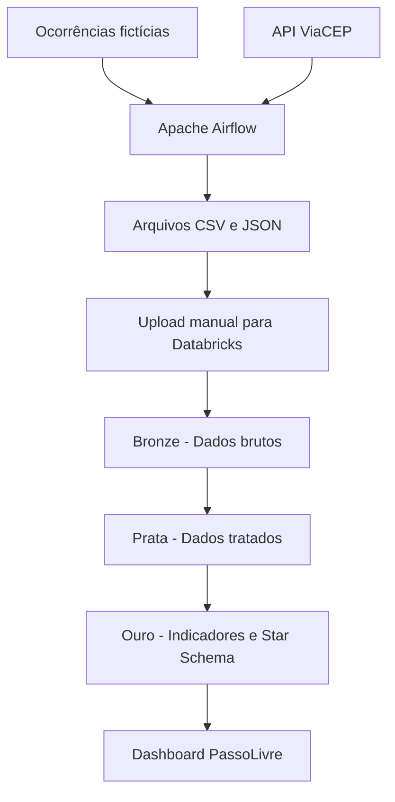

# Integração com o MVP — PassoLivre

## 1. Objetivo

Demonstrar como os dados coletados e processados pelo
pipeline do PassoLivre são disponibilizados para análise
e visualização no MVP analítico.

O MVP implementado consiste no dashboard publicado no
Databricks, denominado "PassoLivre | Painel de
Acessibilidade".

## 2. Arquitetura da integração

## 3. Fluxo implementado

### Coleta

O Apache Airflow executa a DAG `passolivre_coleta`,
responsável pela coleta e organização dos dados de
ocorrências e das respostas do ViaCEP.

Os dados são armazenados localmente em arquivos
CSV e JSON.

### Ingestão

Os arquivos gerados são enviados manualmente para
o volume `/Volumes/workspace/gs/chegada/` no Databricks.

A camada Bronze realiza a ingestão desses arquivos
em tabelas Delta.

### Tratamento

A camada Prata aplica normalização, deduplicação,
validação de qualidade e enriquecimento geográfico.

Os registros são classificados conforme sua qualidade
e disponibilidade de endereço.

### Disponibilização

A camada Ouro gera tabelas analíticas utilizadas pelo
dashboard e pelo modelo dimensional.

As tabelas principais de indicadores são:

- `workspace.gs.ouro_resumo_acessibilidade`
- `workspace.gs.ouro_ocorrencias_por_bairro`
- `workspace.gs.ouro_ocorrencias_por_tipo`

O modelo dimensional utiliza:

- `workspace.gs.dim_tipo_barreira`
- `workspace.gs.dim_localizacao`
- `workspace.gs.fato_ocorrencias`

## 4. Consumo pelo MVP

O dashboard "PassoLivre | Painel de Acessibilidade"
apresenta indicadores e visualizações baseados nas
tabelas analíticas do Databricks.

Entre os indicadores disponibilizados estão:

- Total de ocorrências.
- Ocorrências aptas e pendentes.
- Ocorrências aptas com endereço.
- Percentuais de qualidade e cobertura.
- Distribuição das ocorrências por bairro.
- Distribuição das ocorrências por tipo.
- Quantidade de bloqueios totais.

O dashboard publicado contém nove visualizações
configuradas durante a implementação.

## 5. Resultados da demonstração

O processamento da amostra fictícia apresentou:

| Indicador | Resultado |
|---|---:|
| Ocorrências únicas | 14 |
| Ocorrências aptas | 11 |
| Ocorrências pendentes | 3 |
| Ocorrências aptas com endereço | 10 |
| Percentual de aptas | 78,57% |
| Percentual de aptas com endereço | 71,43% |
| Bloqueios totais mapeados | 3 |

Esses resultados demonstram o fluxo de transformação
dos registros de entrada em informações analíticas.

## 6. Evidências

As evidências de implementação estão armazenadas
na pasta `evidencias/` do projeto.

Elas incluem capturas das execuções do Airflow,
das tabelas no Databricks, do dashboard publicado,
do modelo dimensional e das consultas analíticas.

## 7. Limitações da integração

A integração entre os arquivos locais e o Databricks
utiliza upload manual nesta versão acadêmica.

A execução dos scripts de transformação também foi
realizada no ambiente Databricks durante a construção
do projeto.

Não foi implementada uma API própria para disponibilizar
os dados a uma aplicação externa.

O dashboard demonstra o consumo analítico da camada Ouro,
mas não representa uma aplicação completa de registro,
gestão e acompanhamento de ocorrências.

## 8. Evoluções futuras

Para uma implantação completa, estão previstas como
possibilidades de evolução:

- Automatização da transferência dos arquivos.
- Orquestração das transformações no Databricks.
- API para consulta de ocorrências e indicadores.
- Interface para registro e acompanhamento de barreiras.
- Autenticação e controle de acesso.
- Monitoramento da qualidade e atualização dos dados.

Essas funcionalidades não fazem parte da implementação
atual e são apresentadas como propostas futuras.

## 9. Conclusão

O PassoLivre demonstrou a integração entre coleta,
tratamento, modelagem analítica e visualização de dados.

O dashboard publicado permite consultar indicadores
consolidados produzidos pela arquitetura de dados,
validando o funcionamento do MVP analítico.

Os dados utilizados são fictícios e não representam
a situação real de acessibilidade dos bairros.
