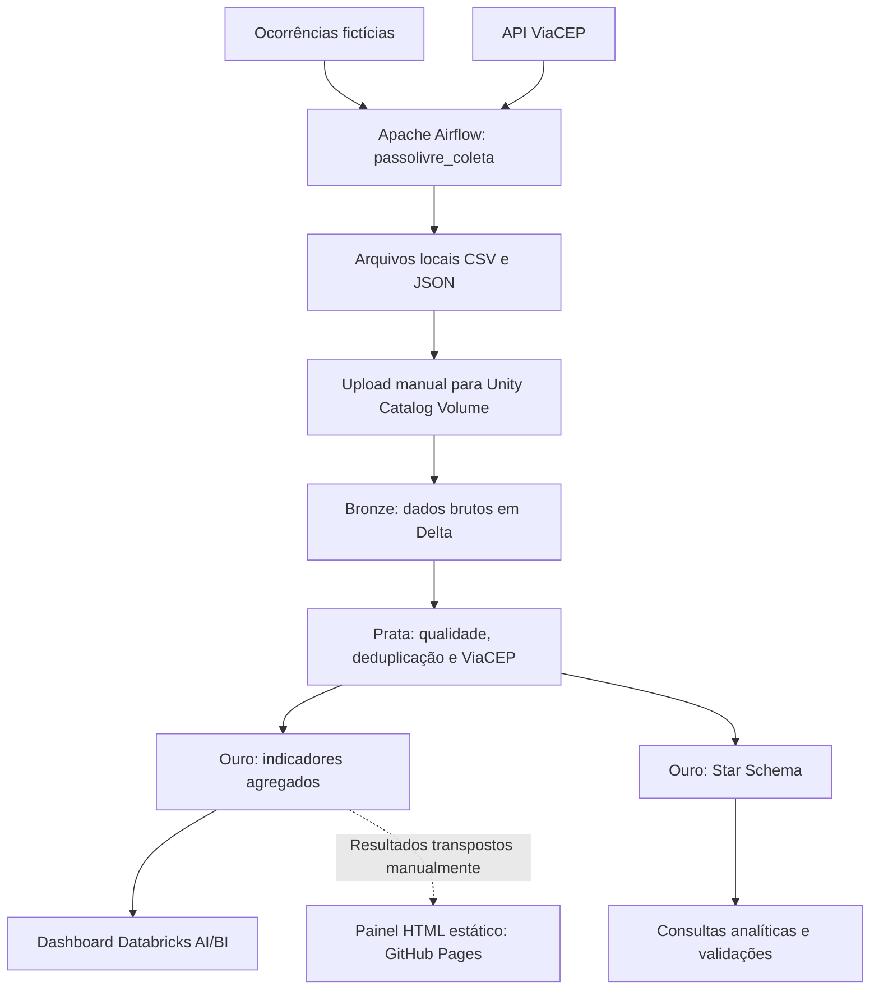

# Integração com o MVP — PassoLivre

## 1. Objetivo

Demonstrar como os dados coletados e processados pelo pipeline do PassoLivre são disponibilizados para análise e visualização. A demonstração acadêmica possui **duas interfaces complementares**:

1. **Dashboard analítico no Databricks AI/BI**, denominado **PassoLivre | Painel de Acessibilidade**, conectado às tabelas de indicadores da camada Ouro dentro do ambiente Databricks.
2. **Painel web público no GitHub Pages**, desenvolvido em HTML, CSS e JavaScript, com uma representação **estática dos resultados validados** e filtros interativos. Ele pode ser acessado sem uma conta Databricks.

- **MVP público:** https://sabi-hase.github.io/passolivre-bigdata/
- **Repositório:** https://github.com/Sabi-Hase/passolivre-bigdata
- **Código do painel público:** [`docs/index.html`](index.html)

Os dados de ocorrências são fictícios e foram usados exclusivamente para a demonstração acadêmica.

## 2. Arquitetura da integração

**Observação:** a ligação pontilhada indica a reprodução manual dos resultados já validados no painel web. **Não existe comunicação automática entre GitHub Pages e Databricks**, nem consulta em tempo real à camada Ouro pelo HTML.

## 3. Fluxo implementado

### 3.1. Coleta

O Apache Airflow executa a DAG [`passolivre_coleta`](../dags/passolivre_coleta.py), responsável por preparar os registros fictícios de ocorrências e consultar os CEPs válidos por meio da API ViaCEP. As tarefas `coletar_ocorrencias` e `coletar_viacep` antecedem `conferir_chegada`.

Os resultados são organizados localmente em arquivos CSV e JSON nas pastas `chegada/ocorrencias/` e `chegada/viacep/`.

### 3.2. Ingestão

Os arquivos gerados são enviados **manualmente** para o Unity Catalog Volume `/Volumes/workspace/gs/chegada/`, nas subpastas `ocorrencias/` e `viacep/`.

A camada Bronze realiza a ingestão em tabelas Delta por meio de `COPY INTO` com `force = false`. A reexecução documentada dos dois comandos não inseriu novos registros, e as contagens se mantiveram em 60 linhas de ocorrências e 24 linhas ViaCEP, distribuídas em quatro arquivos de cada fonte.

### 3.3. Tratamento e enriquecimento

A camada Prata aplica normalização, deduplicação por identificador, regras de qualidade, tratamento das respostas ViaCEP e associação das ocorrências aos endereços. Os registros podem ser classificados como `APTO` ou `PENDENTE`.

A view `workspace.gs.vw_ocorrencias_enriquecidas` reúne as informações de ocorrências e de localização.

### 3.4. Disponibilização analítica

A camada Ouro contém três tabelas de indicadores utilizadas pelo dashboard do Databricks:

- `workspace.gs.ouro_resumo_acessibilidade`
- `workspace.gs.ouro_ocorrencias_por_bairro`
- `workspace.gs.ouro_ocorrencias_por_tipo`

Também foi implementado um modelo dimensional com duas dimensões e uma tabela fato:

- `workspace.gs.dim_tipo_barreira`
- `workspace.gs.dim_localizacao`
- `workspace.gs.fato_ocorrencias`

Esse modelo foi utilizado para executar cinco consultas analíticas e testes de integridade lógica.

## 4. Consumo no dashboard do Databricks

O dashboard **PassoLivre | Painel de Acessibilidade** utiliza datasets SQL baseados nas tabelas agregadas da camada Ouro. Durante a implementação, foram configuradas **nove visualizações**, incluindo indicadores de qualidade e cobertura, ocorrências por bairro e por tipo e bloqueios totais.

O acesso ao dashboard original segue as permissões da conta Databricks. A configuração de compartilhamento disponível na demonstração não oferecia acesso anônimo irrestrito pela internet.

## 5. Painel público no GitHub Pages

Para permitir a avaliação sem autenticação no Databricks, foi criado um painel público hospedado pelo GitHub Pages, a partir do arquivo [`docs/index.html`](index.html).

**Endereço público:** https://sabi-hase.github.io/passolivre-bigdata/

A página apresenta seis indicadores gerais, visualizações agregadas por bairro e tipo de barreira e controles interativos para filtrar o recorte analisado. Os filtros operam **no próprio navegador**, sobre os valores estáticos incorporados ao HTML, e **não alteram as tabelas do Databricks**.

No teste com o bairro **Bela Vista**, o painel exibiu **4 ocorrências**, **2 bloqueios totais** e **50% de ocorrências com bloqueio total**, em concordância com as consultas SQL documentadas.

O acesso ao endereço público foi testado em uma janela privativa do navegador, sem solicitação de login. A publicação foi configurada no GitHub Pages a partir da branch `main`, pasta `/docs`, com HTTPS.

**Limitação essencial:** o painel web é uma **fotografia estática** de indicadores já calculados. Alterações posteriores nas tabelas Bronze, Prata ou Ouro não aparecem automaticamente no GitHub Pages. A atualização desses valores exige uma alteração e nova publicação do HTML.

## 6. Resultados da demonstração

O processamento da amostra fictícia apresentou os seguintes resultados:

| Indicador | Resultado |
|---|---:|
| Ocorrências únicas após deduplicação | 14 |
| Ocorrências aptas | 11 |
| Ocorrências pendentes | 3 |
| Ocorrências aptas com endereço | 10 |
| Percentual de ocorrências aptas | 78,57% |
| Percentual de aptas com endereço | 71,43% |
| Bloqueios totais mapeados nas ocorrências aptas com endereço | 3 |

Na amostra apta com endereço, a Bela Vista apresentou quatro ocorrências e dois bloqueios totais; Pinheiros, duas ocorrências e um bloqueio; Paraíso e Sé, duas ocorrências cada, sem bloqueio total.

Esses números demonstram a capacidade técnica de organizar e apresentar dados; **não comprovam impacto social real** ou problemas existentes nos bairros citados.

## 7. Evidências

As capturas de implementação e validação ficam em `evidencias/`. Entre as evidências pertinentes à integração estão:

- `08_dashboard_publicado_visao_geral.png` — dashboard analítico publicado no Databricks.
- `09_mvp_web_filtro_bela_vista.png` — filtros do painel web em funcionamento.
- `09_mvp_web_publicado.png` — painel público acessado sem login.
- `10_bronze_idempotencia_antes.png` e `10_bronze_idempotencia_depois.png` — contagens antes e depois da reexecução.
- `11_volume_estrutura.png`, `11_volume_ocorrencias.png` e `11_volume_viacep.png` — estrutura e arquivos do Unity Catalog Volume.
- `12_airflow_grid.png` — execuções da DAG no Airflow.

A presença desses arquivos no repositório deve ser conferida após o próximo commit. Capturas atuais do Volume não devem ser apresentadas como registros históricos feitos imediatamente após cada lote.

## 8. Limitações e segurança

A solução é uma **prova de conceito acadêmica**, com as seguintes limitações:

- O envio de arquivos locais ao Databricks e a execução das transformações SQL foram manuais.
- O painel público usa indicadores incorporados ao HTML; não está sincronizado automaticamente com o Databricks.
- Não foi desenvolvida uma API própria nem uma aplicação completa para registrar e acompanhar denúncias.
- Os dados fictícios incluem CEPs de localidades reais, mas não representam ocorrências verificadas nesses endereços.
- A publicação pública deve conter somente dados demonstrativos e não deve expor credenciais, logs, arquivos `.env` ou informações pessoais.

O documento [`lgpd.md`](lgpd.md) descreve os princípios de privacidade e os controles recomendados para uma eventual operação com dados reais.

## 9. Evoluções futuras

Para uma implantação real, podem ser desenvolvidos:

- Transferência automatizada dos arquivos ao Databricks e orquestração das transformações.
- API para consulta controlada de ocorrências e indicadores atualizados.
- Interface de registro e acompanhamento de barreiras de acessibilidade.
- Autenticação, autorização e procedimentos de privacidade adequados ao tratamento de dados reais.
- Monitoramento da qualidade, histórico de atualizações e alertas operacionais.
- Integração de dados reais de fontes verificadas e avaliação dos resultados obtidos após intervenções.

Essas funcionalidades são **propostas futuras**, não componentes implementados na demonstração atual.

## 10. Conclusão

O PassoLivre demonstrou um fluxo completo de **coleta, ingestão, tratamento, modelagem analítica e visualização**. O dashboard no Databricks comprova o consumo das tabelas da camada Ouro no ambiente analítico, enquanto o painel estático no GitHub Pages oferece um **MVP público e interativo**, acessível sem login.

A distinção entre as duas interfaces preserva a transparência técnica: **o painel web apresenta resultados validados, mas não realiza consultas em tempo real ao pipeline**. Os dados utilizados são fictícios e não representam a situação real de acessibilidade urbana.
