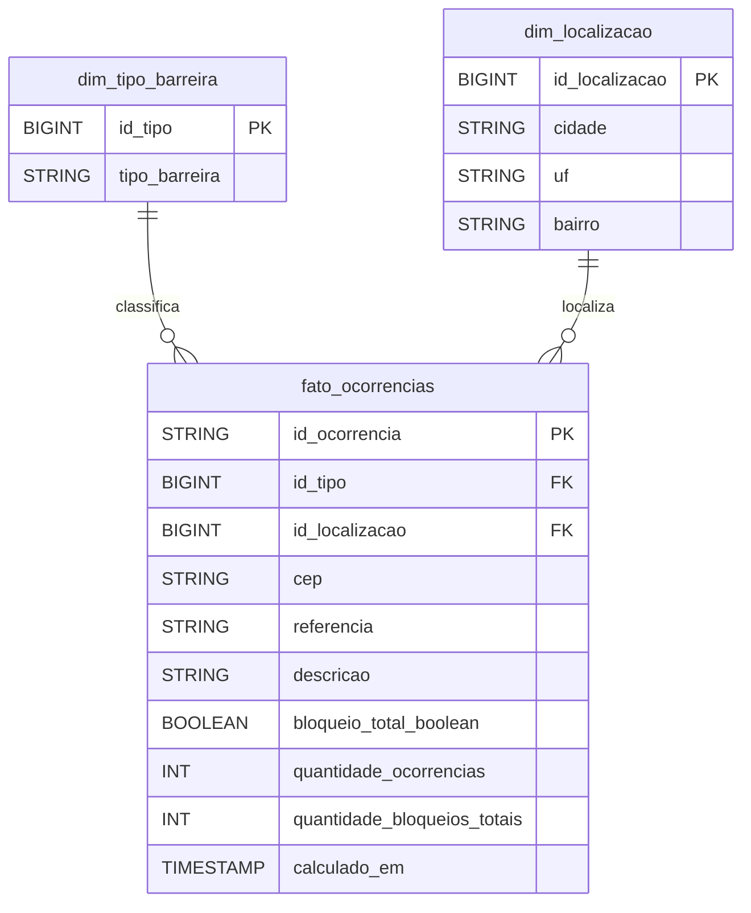

# Modelo Dimensional — PassoLivre

## Star Schema

O modelo dimensional utiliza duas dimensões e uma tabela fato
para analisar ocorrências de barreiras de acessibilidade.

## Granularidade

Cada registro da tabela fato representa uma ocorrência
apta, com endereço encontrado.

## Relacionamentos

- fato_ocorrencias.id_tipo -> dim_tipo_barreira.id_tipo
- fato_ocorrencias.id_localizacao -> dim_localizacao.id_localizacao

As chaves estrangeiras são relacionamentos lógicos,
validados por consultas SQL.

## Validação

- 4 tipos de barreira
- 4 localizações
- 10 ocorrências únicas
- 3 bloqueios totais
- 0 identificadores duplicados
- 0 relacionamentos sem correspondência

## Observação

Os dados utilizados são fictícios e destinam-se
exclusivamente à demonstração acadêmica.
